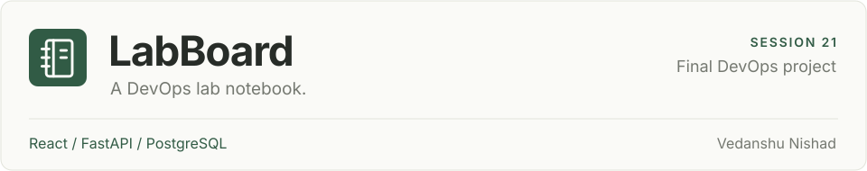
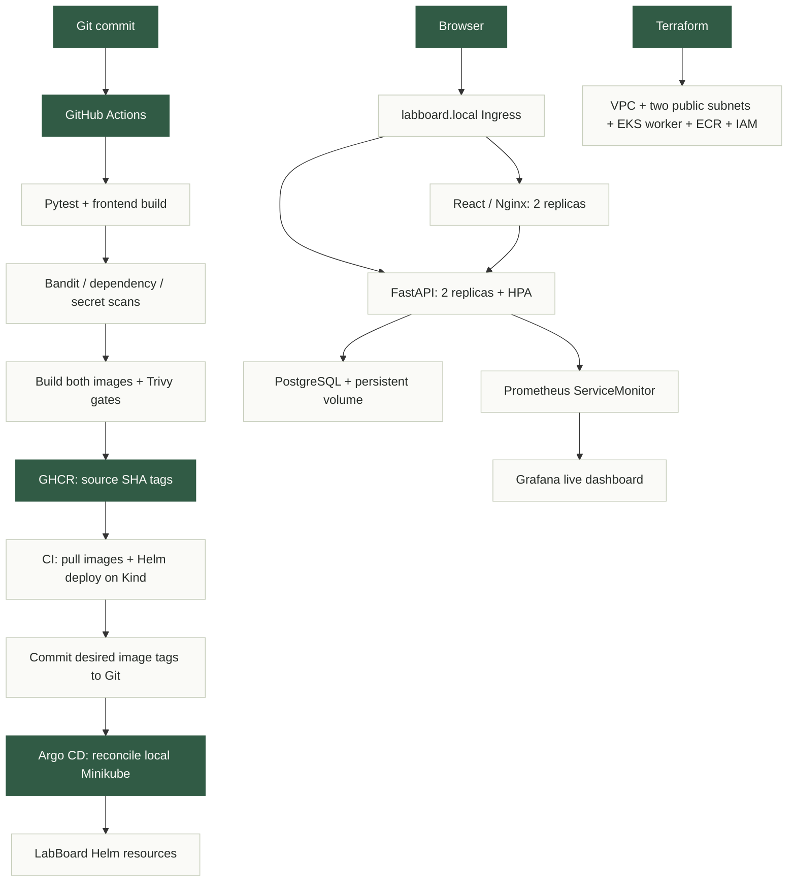
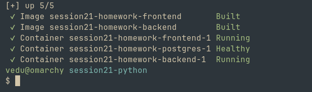

**Vedanshu Nishad** · Session 21 final project

[Overview](#overview) · [Demo](#demo-and-deliverables) · [Run locally](#run-locally) · [Architecture](#architecture) · [Screenshots](#evidence) · [Technical guide](#technical-guide)

**[Watch the demo video →](../demo/LabBoard-Demo.mp4)**

## Overview

LabBoard is my DevOps homework tracker. Create tasks and notes, set priorities, and move work through **To do → In progress → Done**. List and board views share the same saved data, with search, filters, sorting and task statistics.

The project extends the supplied TaskBoard reference with my own lab domain, interface, tests, security fixes and deployment automation.

[](Outputs/ui-list.png)

| What was verified | Result |
| :-- | :-- |
| Application | React + FastAPI + PostgreSQL working in Docker and Kubernetes; 10 API tests passed |
| Delivery | All five CI/CD jobs passed; both published images passed the HIGH/CRITICAL security gates |
| Operations | Persistent storage, monitoring and Argo CD self-healing verified on Minikube |
| Cloud lifecycle | 56 AWS resources created and destroyed; two encryption keys have scheduled deletion dates |

## Demo and deliverables

Both submission files are in the repository-root [`demo/`](../demo/) folder. It contains only the video and PowerPoint.

| Material | Open it |
| :-- | :-- |
| Recorded walkthrough | [Demo video (MP4)](../demo/LabBoard-Demo.mp4) · [Watch on Loom](https://www.loom.com/share/dc6cd8f27360475b8d9eb04c1765e7db) |
| PowerPoint | [14-slide presentation](../demo/LabBoard-Session21.pptx) — what, why, how, stack, trade-offs and the four required screenshots |

## Run locally

From the repository root, switch to the project branch and start the three services:

```bash
git switch session21-python
cd session21-python
docker compose -p session21-homework up --build -d
docker compose -p session21-homework ps
```

Open **[localhost:3000](http://localhost:3000)**. Expect frontend and backend running, with PostgreSQL healthy.

```bash
curl --fail http://localhost:3000/health
curl --fail http://localhost:3000/api/tasks/stats
```

PostgreSQL health checks delay backend startup until the database is ready. Tasks are saved in a named volume. `docker compose -p session21-homework down` stops the stack and keeps that volume; adding `-v` removes the saved data.

## Architecture

| Layer | Tools and role |
| :-- | :-- |
| Application | React/Vite and Nginx serve the interface; Python 3.12 and FastAPI handle requests |
| Data | PostgreSQL 16 stores tasks; SQLAlchemy and Alembic manage data access and migrations |
| Delivery | GitHub Actions, Pytest, Bandit, pip-audit, npm audit and Trivy test and scan; GHCR stores images |
| Operations | Kubernetes and Helm deploy the app; Prometheus and Grafana monitor it; Argo CD keeps it aligned with Git |
| Cloud exercise | Terraform provisions AWS VPC, EKS, ECR and IAM resources for the infrastructure demonstration |

**Where it runs:** Compose is the local setup; CI verifies published images in a disposable **Kind** cluster; the monitored GitOps demonstration runs on **Minikube**. AWS is a separate infrastructure lifecycle exercise. The application was not deployed to EKS for the cloud capture.

<details>
<summary><strong>View the delivery and deployment diagram</strong></summary>



Local Minikube uses images built from the verified source and loaded into its cache. CI independently verifies the exact published GHCR images.

</details>

## Evidence

Expand a group to view its screenshots. Select any image to open it at full size.

<details>
<summary><strong>Submission essentials — repository, CI/CD, Docker Compose and Kubernetes</strong></summary>

**Session 21 project repository**

[](Outputs/github-repository.png)

**Interface update pipeline — all five jobs successful**

[](Outputs/github-pipeline.png)

**Docker Compose services and non-root application users**

[](Outputs/docker-verification.png)

**Running application and database pods with ClusterIP Services**

[](Outputs/kubernetes.png)

</details>

<details>
<summary><strong>Application — board and phone layouts</strong></summary>

**Board view after the interface update**

[](Outputs/ui-board.png)

**Responsive phone layout**

[](Outputs/ui-mobile.png)

</details>

<details>
<summary><strong>Tests, containers and security — 6 captures</strong></summary>

**Ten API tests passing**

[](Outputs/pytest.png)

**Docker Compose build and startup**

[](Outputs/docker-compose-build.png)

**GitHub CLI result — source commit and five successful jobs**

[](Outputs/pipeline-success.png)

**Trivy container security gates**

[](Outputs/trivy-ci.png)

**Published GHCR image pulls and deployment verification**

[](Outputs/registry-deploy.png)

**Repository commit history**

[](Outputs/commit-history.png)

</details>

<details>
<summary><strong>Kubernetes, monitoring and GitOps — 6 captures</strong></summary>

**Persistent storage, Ingress, HPA, Helm release and Argo CD status**

[](Outputs/kubernetes-storage.png)

**Same saved task after replacing the PostgreSQL pod**

[](Outputs/pvc-persistence.png)

**Backend metrics endpoint**

[](Outputs/metrics.png)

**Both backend targets UP in Prometheus**

[](Outputs/prometheus-targets.png)

**Populated Grafana application dashboard**

[](Outputs/grafana-dashboard.png)

**Frontend drift 2 → 1 → 2 and automatic repair**

[](Outputs/gitops-self-heal.png)

</details>

<details>
<summary><strong>Terraform and AWS — provisioning through cleanup</strong></summary>

**Terraform initialization and validation**

[](Outputs/terraform-init.png)

**Reviewed infrastructure plan — 56 resources**

[](Outputs/terraform-plan.png)

**Managed worker plan — one t3.small instance**

[](Outputs/terraform-node-plan.png)

**Completed Terraform apply**

[](Outputs/terraform-apply.png)

**AWS VPC, Active EKS cluster and healthy worker**

[](Outputs/aws-infrastructure.png)

**Public subnets, EC2 worker and ECR repositories**

[](Outputs/aws-resources.png)

**Terraform destroy — 56 resources removed**

[](Outputs/terraform-destroy.png)

**AWS cleanup checks and scheduled encryption-key deletion**

[](Outputs/aws-cleanup.png)

</details>

<details>
<summary><strong>Troubleshooting — failures, repairs and verification</strong></summary>

**Initial image-pull failure and Service routing investigation**

[](Outputs/troubleshooting-failures.png)

**Repairs and successful verification**

[](Outputs/troubleshooting.png)

</details>

All 22 terminal captures came from the actual Foot terminal on **16 October 2026**. Crops retain the original text and pixels. CI captures retrieve a completed GitHub Actions run with its original timestamps. The [capture record](Outputs/foot-captures.json) includes commands, times, crop dimensions and hashes.

## Technical guide

Open the part you need. Commands below start in `session21-python/` unless a block changes directory.

<details>
<summary><strong>Application, API tests and container checks</strong></summary>

### Interface and behavior

The interface uses a paper-and-green palette, a notebook mark, locally bundled Inter typography and compact task rows. Task titles are 15–16 px, body text is 14–16 px, and controls and secondary labels are at least 12 px. All navigation and controls work with the existing API:

- Switch between a task list and a three-column board.
- Search titles, notes and assignees; filter by status or priority; sort by creation order or priority.
- Create and edit tasks, change their status directly, and confirm deletion.
- Failed saves keep the form and entered values available for retry. Dialogs support keyboard focus and Escape; the layout adapts to phones and tablets.

The updated frontend is verified locally through Docker Compose. Browser checks exercised real create/edit/status/delete operations, persistence after reload, filtering, failed-save recovery and layouts at 390, 768, 1024 and 1440 pixels. One disposable verification task was removed after each check; existing tasks were preserved. The interface update also passed all five CI/CD jobs in [run 38303472047](https://github.com/vedanshun05/devops-heros/actions/runs/38303472047).

### Run the API tests

From `session21-python/`:

```bash
python -m venv .venv
source .venv/bin/activate
pip install -r backend/requirements.txt
cd backend
pytest -v
```

Tests create a fresh in-memory SQLite database for each case and override FastAPI's database dependency. They never use the running PostgreSQL database. Production containers apply the Alembic migration before serving requests.

| Endpoint | Purpose |
| :-- | :-- |
| `GET /health` | Process liveness |
| `GET /ready` | Database readiness |
| `GET /metrics` | Prometheus metrics |
| `GET /api/tasks` / `GET /api/tasks/{id}` | List / retrieve tasks |
| `POST /api/tasks` | Create a task |
| `PUT /api/tasks/{id}` | Update a task |
| `DELETE /api/tasks/{id}` | Delete a task |
| `GET /api/tasks/stats` | Dashboard totals |

### Container checks

```bash
docker compose -p session21-homework exec backend id
docker compose -p session21-homework exec frontend id
```

The backend runs as UID 10001 and frontend as UID 101. The frontend uses a multistage build. The Compose password is a disposable local demonstration value; Kubernetes uses a separate generated runtime Secret. Existing `taskboard` Helm/resource names are retained for compatibility.

</details>

<details>
<summary><strong>CI/CD, registry and security results</strong></summary>

The active workflow is [`.github/workflows/session21-ci-cd.yml`](../.github/workflows/session21-ci-cd.yml). Its copy inside this session is provided with the coursework; GitHub executes the repository-root workflow.

Pushes affecting application, chart, Compose or workflow code on **`session21-python`** trigger the pipeline; manual dispatch is also supported. This respects the branch-specific submission design. The reference rubric's `main` trigger is adapted to the submitted branch. Documentation, screenshots and GitOps promotion commits do not cause an image-build loop.

1. **test:** ten API tests and the frontend production build.
2. **security:** Bandit SAST, Python and Node SCA, Trivy secret scanning.
3. **images:** build both images; fail on HIGH/CRITICAL CVEs; push to GHCR using the source SHA.
4. **deploy:** authenticate to GHCR, pull those exact published images, load Kind, create a runtime DB Secret, deploy Helm and verify health/task API through the frontend proxy.
5. **gitops:** promote the verified image tags in `gitops/values.yaml` with a bot commit.

The interface update passed [run 38303472047](https://github.com/vedanshun05/devops-heros/actions/runs/38303472047). The current GitOps configuration records source commit `9843e0ee0d459034b5970dbf5e40f1cf83d777b9` in both image tags:

- `ghcr.io/vedanshun05/labboard-backend:9843e0ee0d459034b5970dbf5e40f1cf83d777b9`
- `ghcr.io/vedanshun05/labboard-frontend:9843e0ee0d459034b5970dbf5e40f1cf83d777b9`

The earlier [capstone run 37946699543](https://github.com/vedanshun05/devops-heros/actions/runs/37946699543) used source `0760dda471aaf010996527177f6966506dff4ade`. The CI terminal screenshots now retrieve the interface-update run through the GitHub CLI in Foot, retaining the original CI timestamps.

GHCR packages may require authentication. CI uses job-scoped `GITHUB_TOKEN` permissions; a separate cluster pulling private packages needs an `imagePullSecret` with package read access. Credentials are supplied at runtime and are not stored in this repository.

### Security results

The original Python dependency graph contained vulnerable dependencies, and the original frontend image failed its gate. The final dependency lock, Alpine backend and updated unprivileged Nginx runtime passed SCA and container gates. A custom `prometheus_client` middleware replaces the old metrics wrapper so the app can use the repaired dependency graph.

Trivy scanned OS packages and application dependencies in both images. The CI result was **zero HIGH/CRITICAL findings** at scan time, with `exit-code: 1` configured for failures. This result describes that severity gate and database snapshot; it is not a claim that future vulnerabilities cannot appear.

</details>

<details>
<summary><strong>Kubernetes and Helm deployment</strong></summary>

The chart is [helm/taskboard](helm/taskboard). It creates Deployments, ClusterIP Services, a ConfigMap, a PostgreSQL StatefulSet/PVC, optional Ingress, backend HPA, probes and optional ServiceMonitor. Namespace bootstrap is [k8s/namespace.yaml](k8s/namespace.yaml).

```bash
minikube start
minikube addons enable ingress
minikube addons enable metrics-server
kubectl apply -f k8s/namespace.yaml
LAB_DB_PASSWORD="$(openssl rand -hex 24)"
kubectl create secret generic taskboard-postgres -n taskboard   --from-literal=username=taskboard --from-literal=password="$LAB_DB_PASSWORD"
unset LAB_DB_PASSWORD
# Load matching locally built images into Minikube, or configure GHCR pull access.
helm upgrade --install taskboard helm/taskboard -n taskboard   -f gitops/values.yaml --wait --timeout 5m
kubectl get pods,svc,pvc,ingress,hpa -n taskboard
helm list -n taskboard
curl --fail -H 'Host: labboard.local' "http://$(minikube ip)/api/tasks/stats"
```

For browser access, map `labboard.local` to the Minikube IP in your local DNS/hosts configuration. The screenshot was captured with a browser host-resolution rule, without changing system configuration. Ingress sends `/` to the frontend and `/api` to backend port 8000. Nginx also proxies API and health requests to the backend Service.

The backend has startup, readiness and liveness probes, CPU/memory requests and limits. HPA targets 60% CPU and keeps 2–6 replicas. Argo CD ignores the backend's replica field so HPA and GitOps do not fight each other.

A task was created, the PostgreSQL pod deleted, and the same task read after the replacement pod became Ready. Its ID and content persisted on the Bound 5 GiB PVC.

</details>

<details>
<summary><strong>Terraform, AWS verification and cleanup</strong></summary>

The [terraform directory](terraform) contains valid HCL, pinned VPC/EKS module versions, provider constraints and an example variable file. It provisions a VPC with two public subnets, one managed EKS worker, API access restricted to the operator's IP, ECR repositories, EBS CSI/IRSA and supporting IAM/KMS resources. EBS CSI uses one controller replica and creates the default StorageClass for this single-worker lab. The lab has no NAT gateway. Public-subnet workers are a short-lived lab choice.

```bash
cd terraform
aws sts get-caller-identity
terraform init
terraform fmt -check
terraform validate
# Supply your own current public IPv4 CIDR, not the documentation example.
terraform plan -var='allowed_cidrs=["YOUR_PUBLIC_IP/32"]' -out=lab.tfplan
terraform apply lab.tfplan
terraform output
# After evidence, destroy using the same state and inputs.
terraform destroy -var='allowed_cidrs=["YOUR_PUBLIC_IP/32"]'
terraform state list
```

On **16 October 2026**, the reviewed plan created **56 resources**. The EKS 1.35 cluster and managed node group became Active, the single `t3.small` EC2 worker was Healthy, and `kubectl get nodes` showed it Ready. Both ECR repositories used immutable image tags. These checks were run in the actual Foot terminal. The application itself was demonstrated on Minikube; no application workload was deployed to EKS for this infrastructure capture.

The original 9 October run encountered an account restriction on `t3.medium` and expired credentials during provisioning. The refreshed run uses the corrected `t3.small` configuration and refreshable, short-lived AWS credentials. Terraform's pinned provider receives those credentials through a temporary AWS CLI credential process. Credentials, saved plans, state and caches are excluded from Git.

An existing IAM login assumed the Terraform-created operator role for the EKS node check. No IAM user or permanent access key was created for this homework. After the screenshots, the reviewed destroy plan contained the same **56 managed resources**, with no additions or changes.

**Cleanup verified — 16 October 2026:** the reviewed destroy plan removed **56 resources**, and `terraform state list` is empty. AWS queries show no lab EKS cluster, VPC or ECR repositories, and the verified worker is terminated. The disposable worker paused in `Terminating:Wait`; its termination hook was continued, then Terraform finished cleanup. Two encryption keys remain in `PendingDeletion`: the earlier run's key until **8 November 2026**, and this capture run's key until **15 November 2026**. Their deletion is scheduled, rather than immediate.

</details>

<details>
<summary><strong>Monitoring and logs</strong></summary>

```bash
helm repo add prometheus-community https://prometheus-community.github.io/helm-charts
helm repo update
helm upgrade --install monitoring prometheus-community/kube-prometheus-stack   --version 92.2.0 --namespace monitoring --create-namespace   -f monitoring/prometheus-values.yaml --wait --timeout 5m
helm upgrade taskboard helm/taskboard -n taskboard --reuse-values   --set monitoring.serviceMonitor.enabled=true
kubectl port-forward -n monitoring svc/monitoring-kube-prometheus-prometheus 19090:9090
# In another terminal:
kubectl port-forward -n monitoring svc/monitoring-grafana 13100:80
kubectl logs -n taskboard deployment/taskboard-taskboard-backend --tail=30
```

Prometheus scrapes `/metrics` through the ServiceMonitor every 15 seconds. Both backend targets were UP with no scrape errors. HTTP counters use route templates to avoid a separate label for every task ID; the histogram records request duration. Process metrics provide CPU time and memory usage.

Open Prometheus at `http://localhost:19090/targets?search=taskboard` and Grafana at `http://localhost:13100/d/labboard/labboard-application-health`. Anonymous Grafana Viewer access is enabled for this disposable local demo through a localhost port-forward. Configure authenticated access before wider exposure.

</details>

<details>
<summary><strong>GitOps demonstration</strong></summary>

Argo CD watches the submitted `session21-python` branch and renders the same Helm chart with its base values and `gitops/values.yaml`. [gitops/application.yaml](gitops/application.yaml) enables automatic sync, pruning and self-healing, while respecting the HPA-managed replica field.

```bash
# Argo CD v3.5.4 was installed in namespace argocd for this run.
kubectl apply -f gitops/application.yaml
kubectl get application labboard -n argocd
```

The successful pipeline promoted its SHA image versions to Git. Commit `3508aa3` then changed the replica count from 2 to 3; Argo CD automatically applied it. A manual scale to 1 drifted from Git and self-healed to 3. Commit `e0c1613` restored the final count to 2, and the Application returned to Synced/Healthy. These GitOps commits are separate from the tested image source SHA. The 16 October Foot capture repeats the drift check against the current Git setting: frontend 2 → 1 → 2, followed by Synced / Healthy status.

</details>

<details>
<summary><strong>Troubleshooting and repairs</strong></summary>

The supplied broken manifests are intentionally retained for replay. The repairs were applied to their temporary live resources, verified, then those exercise resources were deleted.

| Issue | Investigation and root cause | Repair and verification |
| :-- | :-- | :-- |
| Bad image | Pod status/events showed an image-pull failure; the example GHCR tag does not exist | Replace its pod spec with the working backend spec, including valid image and DB references; rollout completed and pod became Running |
| Empty endpoints | `broken-service` selected `label-that-does-not-exist`; EndpointSlice had no endpoints | Select `app: taskboard-backend`; set targetPort 8000; EndpointSlice contained both pod IPs and `/health` returned UP through the repaired Service |
| AWS worker could not launch (original 9 October run) | Auto Scaling activity showed Free Tier eligibility rejection | Change Terraform to eligible `t3.small`; node group Active and instance Healthy |
| Stalled AWS authentication (original 9 October run) | Expired temporary credentials interrupted the original apply | Refresh through a credential process; reconcile the confirmed existing cluster before continuing |

```bash
kubectl apply -f troubleshooting/broken-image.yaml -f troubleshooting/broken-service.yaml
kubectl get pods -n taskboard -l app=broken-image
kubectl get events -n taskboard --sort-by=.lastTimestamp
kubectl get endpointslices -n taskboard -l kubernetes.io/service-name=broken-service
# Inspect and repair the live resources, then remove the exercise objects:
kubectl delete -f troubleshooting/broken-image.yaml -f troubleshooting/broken-service.yaml
```

</details>

<details>
<summary><strong>Full verification record and dates</strong></summary>

**Evidence dates:** initial capstone — 9 October 2026; interface and CI update — 13 October 2026; Foot captures — 16 October 2026.

| Area | Evidence |
| :-- | :-- |
| Application | React UI + FastAPI CRUD + PostgreSQL/Alembic working in Docker and Kubernetes |
| Tests | 10 isolated SQLite API tests pass; health, readiness, CRUD, stats, metrics and invalid input covered |
| Containers | Three Compose services run; backend UID 10001 and frontend UID 101; frontend has a multistage build |
| CI/CD | All five jobs passed for the interface update in [run 38303472047](https://github.com/vedanshun05/devops-heros/actions/runs/38303472047) |
| Security | Bandit, pip-audit, npm audit, secret scan and both HIGH/CRITICAL container gates pass |
| Registry | Both GHCR images published with the full source commit SHA; CI pulls those published images for deployment |
| Kubernetes | Helm release; two frontend and two backend replicas, PostgreSQL StatefulSet/PVC, Services, Ingress, HPA and probes |
| Monitoring | Both backend targets UP; Grafana shows live HTTP requests, memory, CPU and health |
| GitOps | Argo CD Synced/Healthy; fresh Foot capture shows frontend drift 2 → 1 restored automatically to 2 |
| Cloud | VPC + two public subnets + EKS 1.35 Active + one Healthy t3.small worker + two ECR repositories; cleanup recorded below |
| Troubleshooting | Image-pull failure and empty Service endpoints reproduced, investigated, repaired and verified |

</details>

## Lessons learned

- Readiness, liveness and database availability answer different questions; the chart and API check each explicitly.
- A Service selector and target port must match the actual pods; Running pods alone do not prove routing works.
- PVC persistence was verified by deleting the database pod, rather than inferred from the manifest.
- Scan dependencies and runtime OS packages; non-root execution and a clean CVE gate provide different protections.
- Keep HPA ownership separate from GitOps replica reconciliation.
- Long cloud operations need refreshable credentials, account-compatible instance types and a retained Terraform state for cleanup.

[Back to overview ↑](#overview)
